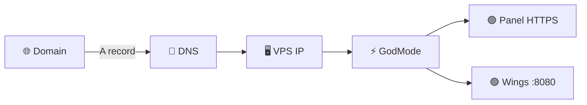
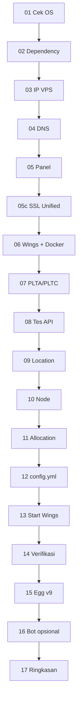

<!-- ============================================================
  Panel-Healer — README profesional
  https://github.com/Rafflie-CH/Panel-Healer
  RAFZHOST × DEKZYMARKET
  ============================================================ -->

<p align="center">
  
</p>

<p align="center">
  
</p>

<p align="center">
  <b>Toolkit Pterodactyl all-in-one</b> — install · heal · automation<br/>
  <i>Satu repo untuk panel game server di VPS, dirancang biar pemula pun bisa.</i>
</p>

<p align="center">
  
  
  
  
  
</p>

<p align="center">
  
  
  
  
</p>

<p align="center">
  
  
  
  
  
</p>

<p align="center">
  <a href="https://t.me/rafzbotz"></a>
  <a href="https://t.me/rafzch"></a>
  <a href="https://t.me/rafzhost"></a>
</p>

---

<p align="center">
  
</p>

## 📑 Daftar Isi

<table>
<tr>
<td width="50%" valign="top">

1. [✨ Banner & kontak](#-hubungi-kami)
2. [🚀 One-liner siap salin](#-one-liner-siap-salin--klik-copy-di-blok-kode)
3. [🎯 Apa ini?](#-apa-ini)
4. [📚 Istilah](#-istilah-wajib-dipahami)
5. [📁 Struktur repo](#-struktur-repo)
6. [📋 Persyaratan](#-persyaratan-vps--dns)
7. [🎓 Tutorial pemula](#-tutorial-pemula-dari-nol-sampai-panel-hidup)
8. [🖥 Cara masuk VPS (SSH)](#-cara-masuk-vps-ssh)
9. [🚀 GodMode](#-godmode-installer-v39)
10. [🩺 Healer](#-healer-toolkit-v35)

</td>
<td width="50%" valign="top">

11. [🤖 bot.zip](#-botzip--create-panel)
12. [🌐 Tunnel](#-vps-tunnelling)
13. [🗑 Uninstall](#-uninstall--reset)
14. [⚙️ Non-interactive](#-mode-otomatis-env)
15. [📄 Log & output](#-file-hasil--log)
16. [🧪 Contoh sesi](#-contoh-sesi-end-to-end)
17. [❓ FAQ](#-faq--error-umum)
18. [🔐 Keamanan](#-keamanan)
19. [🛣 Progress](#-progress--roadmap)
20. [📜 Changelog](#-changelog)
21. [💡 Filosofi](#-filosofi-kisah--pesan-mandiri)
22. [🙏 Credits](#-credits)

</td>
</tr>
</table>

---

## 📬 Hubungi kami

> [!IMPORTANT]
> **Ada error?** Langsung lapor ke Telegram **[@rafzbotz](https://t.me/rafzbotz)**  
> Sertakan screenshot + `tail -50 /root/ptero_install.log` (sensor password & token).

| | Akun | Link | Fungsi |
|:---:|:-----|:-----|:-------|
| 🆘 | **@rafzbotz** | [t.me/rafzbotz](https://t.me/rafzbotz) | Akun utama — **lapor error / tanya teknis** |
| 📣 | **@rafzch** | [t.me/rafzch](https://t.me/rafzch) | Channel testimoni, produk, promo |
| ℹ️ | **@rafzhost** | [t.me/rafzhost](https://t.me/rafzhost) | Jam kerja, partner, pengumuman |

<p align="center">
  <a href="https://t.me/rafzbotz"></a>
  <a href="https://t.me/rafzch"></a>
  <a href="https://t.me/rafzhost"></a>
</p>

<details>
<summary><b>📋 Template lapor error (klik buka)</b></summary>

```text
1. Perintah yang dijalankan:
2. OS VPS (Ubuntu 22.04 / 24.04):
3. Screenshot terminal:
4. Output log:
   tail -50 /root/ptero_install.log
5. Domain panel / node (opsional):

⚠️ JANGAN kirim password admin, PLTA, PLTC, atau token bot.
```

</details>

---

## 🚀 One-liner siap salin

> [!TIP]
> Di GitHub: arahkan kursor ke kanan atas blok kode → ikon **Copy** → tempel di terminal VPS (root) → Enter.

<br/>

### 1️⃣ GodMode — Install panel penuh

<p align="center">
  
</p>

```bash
bash <(curl -sL https://raw.githubusercontent.com/Rafflie-CH/Panel-Healer/main/godmode.sh)
```

| | |
|:--|:--|
| **File** | [`godmode.sh`](https://raw.githubusercontent.com/Rafflie-CH/Panel-Healer/main/godmode.sh) |
| **Versi** | `v3.9` |
| **Untuk** | VPS baru / install dari nol |
| **Hasil** | Panel + Wings + Node + Egg (+ bot opsional) |

<br/>

### 2️⃣ Healer — Perbaiki panel yang sudah ada

<p align="center">
  
</p>

```bash
bash <(curl -sL https://raw.githubusercontent.com/Rafflie-CH/Panel-Healer/main/healer.sh)
```

| | |
|:--|:--|
| **File** | [`healer.sh`](https://raw.githubusercontent.com/Rafflie-CH/Panel-Healer/main/healer.sh) |
| **Versi** | `v3.5` |
| **Untuk** | Panel error, disk penuh, Docker rusak, stuck loading |
| **Hasil** | Menu perbaikan interaktif + auto-diagnosa |

<br/>

### 3️⃣ VPS Tunnelling (repo terpisah)

<p align="center">
  
</p>

```bash
bash <(curl -s https://raw.githubusercontent.com/Rafflie-CH/vps-tunelling/main/bash.sh)
```

| | |
|:--|:--|
| **Repo** | [Rafflie-CH/vps-tunelling](https://github.com/Rafflie-CH/vps-tunelling) |
| **Untuk** | Tunnel / expose layanan VPS |

---

## 🎯 Apa ini?

```text
┌─────────────────────────────────────────────────────────────┐
│  Panel-Healer = toolbox bash untuk Pterodactyl di VPS      │
│                                                             │
│  godmode.sh  →  PASANG panel + wings + egg + bot            │
│  healer.sh   →  PERBAIKI vps / panel yang bermasalah        │
│  bot.zip     →  BOT Telegram "Create Panel"                 │
└─────────────────────────────────────────────────────────────┘
```

| Komponen | Badge | Fungsi satu kalimat |
|:---------|:-----:|:--------------------|
| **godmode.sh** |  | Satu perintah → Panel + Wings + Location + Node + Allocation + Egg + (opsional) bot |
| **healer.sh** |  | Dashboard diagnosa & perbaikan (dpkg, deep clean, docker, rate-limit, hama) |
| **bot.zip** |  | Bot **Create Panel** — user chat Telegram → server Pterodactyl terbuat |

### ⚠️ “CPanel” di sini = Create Panel — BUKAN cPanel hosting

> [!WARNING]
> **CPanel / Create Panel** = bot Telegram untuk **membuat (create) server** di Pterodactyl.  
> **Bukan** software hosting **cPanel** (cpanel.net), bukan port 2083.

| ✅ Maksud repo ini | ❌ Bukan ini |
|:-------------------|:-------------|
| **C**reate **Panel** — bot bikin server Pterodactyl | cPanel hosting web komersial |
| Prompt GodMode: *“pasang bot CPanel?”* = pasang bot Telegram | Install cPanel di VPS |

---

## 📚 Istilah wajib dipahami

<details open>
<summary><b>Klik untuk buka/tutup kamus singkat</b></summary>

| Istilah | Arti sederhana |
|:--------|:---------------|
| **VPS** | Komputer sewa di cloud (DigitalOcean, Contabo, dll.) |
| **SSH** | Cara masuk ke VPS lewat terminal jarak jauh |
| **Root** | Akun super-admin Linux — script ini **wajib root** |
| **Domain** | Nama seperti `panel.namamu.com` |
| **DNS A record** | Pengaturan domain → angka IP VPS |
| **Pterodactyl Panel** | Website admin kelola server game/bot |
| **Wings** | Program di VPS yang menjalankan server (Docker) |
| **Docker** | “Kotak” isolasi tempat server berjalan |
| **Allocation** | IP + port (contoh `1.2.3.4:25565`) |
| **Egg** | Template cara jalankan server (startup, image, variabel) |
| **PLTA** | API key Application (buat node/server lewat API) |
| **PLTC** | API key Client (start/stop server) |
| **SSL / Let's Encrypt** | HTTPS / gembok hijau di browser |
| **One-liner** | Satu baris perintah unduh + jalankan script |
| **CPanel (di sini)** | **Create Panel** — bot Telegram (**bukan** cPanel hosting) |

</details>

---

## 📁 Struktur repo

```text
📦 Panel-Healer
 ┣ 📜 godmode.sh     ─── Installer utama (v3.9)          ✅ wajib
 ┣ 📜 healer.sh      ─── Toolkit perbaikan (v3.5)        ✅ wajib
 ┣ 📦 bot.zip        ─── Bot Telegram Create Panel       ✅ jika pakai bot
 ┣ 📜 test.sh        ─── Util / test                     ⚪ opsional
 ┗ 📄 README.md      ─── Dokumentasi ini
```

> [!NOTE]
> **`bot.zip` harus tetap berbentuk ZIP** di branch `main`.  
> Jangan extract ke repo. GodMode yang extract ke volume server.

---

## 📋 Persyaratan VPS & DNS

### VPS

| Item | Minimal | Disarankan |
|:-----|:-------:|:----------:|
| 🖥 OS | Ubuntu **22.04 / 24.04** | 24.04 |
| ⚙️ CPU | 2 vCPU | 4 vCPU |
| 🧠 RAM | 2 GB | **4 GB+** |
| 💾 Disk | 20 GB bebas | 40 GB+ SSD |
| 👤 Akses | **root** | root + SSH key |
| 🔥 Firewall | 80, 443, 8080, 2022 | + port game |

```bash
cat /etc/os-release
whoami    # harus: root
```

### DNS (wajib sebelum install)

| Peran | Contoh | Tipe | Value |
|:------|:-------|:----:|:------|
| Panel | `panel.contoh.com` | **A** | IP publik VPS |
| Node | `node.contoh.com` | **A** | IP publik VPS **sama** |

```bash
dig +short panel.contoh.com @8.8.8.8
dig +short node.contoh.com  @8.8.8.8
```

Kedua hasil harus = IP VPS. Kalau belum → tunggu propagasi DNS.



---

## 🎓 Tutorial pemula: dari nol sampai panel hidup

> [!TIP]
> Ikuti **urut A → K**. Jangan loncat. Cocok untuk yang belum pernah ngoding.

| Step | Judul | Ringkas |
|:----:|:------|:--------|
| **A** | Sewa VPS | Catat IP + password root |
| **B** | DNS | 2× A record → IP VPS |
| **C** | SSH | Masuk VPS (Colab / Termius / PC) |
| **D** | Root | `sudo su` → `whoami` = root |
| **E** | GodMode | Tempel one-liner install |
| **F** | Menu | Pilih **`1`** Install |
| **G** | Isi form | Domain, email, user, password, bot? |
| **H** | Tunggu | 10–30 menit, jangan tutup SSH |
| **I** | Login | Browser → `https://domain-panel` |
| **J** | Error? | Log + screenshot → [@rafzbotz](https://t.me/rafzbotz) |
| **K** | Rusak nanti | Jalankan **Healer**, jangan reinstall dulu |

### Detail singkat per langkah

**A–B** — Beli VPS Ubuntu, arahkan `panel` & `node` ke IP.  
**C** — Lihat [Cara masuk VPS](#-cara-masuk-vps-ssh).  
**D** — Pastikan prompt root.  
**E** — Salin perintah GodMode di atas.  
**F–G** — Jawab pertanyaan; Enter = default. Domain panel ≠ domain node.  
**H** — Log: `tail -f /root/ptero_install.log`  
**I** — Pakai username/password yang kamu isi (atau `/root/rafzhost-panel-data.txt`).  
**J** — Sensor rahasia sebelum kirim.  
**K** — One-liner Healer.

---

## 🖥 Cara masuk VPS (SSH)

Pilih **satu** metode.

### ① Google Colab — tanpa PC, tanpa Termux

<p align="center">
  
</p>

1. Buka **[https://colab.new](https://colab.new)** (login Google).
2. Buka **Terminal** (ikon `>_` di panel Colab).
3. Ketik:

```bash
ssh root@IP_VPS_KAMU
```

4. Fingerprint? → ketik `yes`.  
5. Password root (ketikan **tidak terlihat** — normal) → Enter.  
6. Berhasil jika muncul `root@...:~#`.

> Sesi Colab bisa putus saat idle. Ulangi `ssh` jika terputus.

### ② Termius — HP Android / iOS / PC

<p align="center">
  
</p>

1. Install **Termius** (Play Store / App Store / [termius.com](https://termius.com/)).
2. **+** → **New Host**.
3. Isi:
   - **Address:** IP VPS  
   - **Port:** `22`  
   - **Username:** `root`  
   - **Password:** password VPS  
4. **Save** → ketuk host → **Connect**.  
5. Accept fingerprint jika diminta.

**Tips:** aktifkan Keep-alive; jangan screenshot password; bisa simpan banyak host.

### ③ App SSH lain (HP)

Server Auditor, JuiceSSH, dll. — pola sama: IP + `root` + password + port 22.

### ④ Windows / Linux / Mac

```bash
ssh root@IP_VPS
```

PuTTY: Host Name = IP → Open → login `root`.

---

## 🚀 GodMode Installer (v3.9)

<p align="center">
  
  
</p>

**File:** [`godmode.sh`](https://raw.githubusercontent.com/Rafflie-CH/Panel-Healer/main/godmode.sh)

### Fitur

| # | Fitur | Keterangan |
|:-:|:------|:-----------|
| 01 | Panel + Wings 1 mesin | Upstream pterodactyl-installer + patch RAFZ |
| 02 | Location / Node / Allocation | Otomatis lewat Application API |
| 03 | Egg Nusantara Ultimate **v9** | PM2, SSH, Yarn/NPM, Python, Cloudflared |
| 04 | Proteksi egg | Non-root dipersulit export / salin startup |
| 05 | SSL **Unified** | 1 cert LE untuk panel + node |
| 06 | Rate-limit LE | Staging/self-signed + cron retry 6 jam |
| 07 | Wings native TLS **:8080** | Tanpa nginx reverse-proxy daemon |
| 08 | Bot Create Panel | Opsional — server + settings.js + start |
| 09 | Menu uninstall | Reset VPS / panel / wings / both |
| 10 | UI berwarna | Palette cyberpunk ala Healer |
| 11 | Log + data file | `ptero_install.log` + `rafzhost-panel-data.txt` |
| 12 | Mode ENV | Non-interactive automation |

### Menu interaktif

```text
════════════════════════════════════════════════════════════
  RAFZHOST × DEKZYMARKET · GOD MODE v3.9
════════════════════════════════════════════════════════════
  [1]  Install Panel + Wings + Egg
  [2]  Uninstall — Reset VPS (Deep Clean)     ← ketik YES
  [3]  Uninstall Panel saja
  [4]  Uninstall Wings / Node saja
  [5]  Uninstall Panel + Wings
════════════════════════════════════════════════════════════
```

### Prompt install (menu 1)

| # | Pertanyaan | Contoh | Wajib |
|:-:|:-----------|:-------|:----:|
| 1 | Domain Panel | `panel.contoh.com` | ✅ |
| 2 | Domain Node | `node.contoh.com` | ✅ |
| 3 | Email Admin | `admin@gmail.com` | ✅ |
| 4 | Username | `admin` | ✅ |
| 5–6 | Nama depan/belakang | Admin / Rafz | ⚪ |
| 7 | Password Admin | •••••• | ✅ |
| 8 | Alias Allocation | `NODE-01` | ⚪ |
| 9 | Pasang bot CPanel? | `y` / `n` | ⚪ |
| 10–11 | Token + Owner ID | BotFather + userinfobot | jika y |
| 12–13 | Cloudflare | domain / zone / key | jika y |

**Otomatis:** IP VPS, port **2000–2999**, location `RafzHost`, hostname mesin.

### Pipeline internal



| Step | Nama | Bahasa manusia |
|:----:|:-----|:---------------|
| 01–04 | Persiapan | OS, tools, IP, DNS harus match |
| 05–05c | Panel + SSL | Website admin + HTTPS |
| 06–07 | Wings + keys | Docker, daemon, API keys |
| 08–11 | Struktur panel | Location, node, port range |
| 12–14 | Hubungkan | Config wings, start, tes panel↔wings |
| 15–16 | Egg + bot | Template server + bot Telegram |
| 17 | Selesai | Cetak login & path log |

### SSL

- Cert name: **`rafzhost-ssl`** (panel + node).  
- Rate limit → staging/self-signed + cron `/usr/local/bin/rafz-ssl-retry` tiap 6 jam.  

```bash
sudo /usr/local/bin/rafz-ssl-retry
```

---

## 🩺 Healer Toolkit (v3.5)

<p align="center">
  
</p>

**File:** [`healer.sh`](https://raw.githubusercontent.com/Rafflie-CH/Panel-Healer/main/healer.sh)

Dashboard berwarna + **auto-check** setiap buka menu.

| Cek otomatis | Ambang | Saran menu |
|:-------------|:------:|:-----------|
| Koneksi :80/:443 | > 350 | **09** |
| Koneksi :8080 | > 200 | **09** / **07** |
| Nginx abort socket | ada di log | **09** |
| Wings inactive | — | **05** / **06** |

### Menu

| Kode | Nama | Untuk pemula | Risiko |
|:----:|:-----|:-------------|:------:|
| **01** | 🔒 Fix DPKG Lock | Apt/dpkg macet | 🟢 |
| **02** | ☢️ Deep Clean | Hapus hampir semua jejak panel/docker/db | 🔴 backup dulu |
| **03** | 🧹 Quick Clean Disk | Log & cache | 🟢 |
| **04** | 🧨 Wipe Volumes | Data server nyangkut | 🟠 |
| **05** | 🔌 Fix Docker Socket | Wings tak nyambung Docker | 🟡 |
| **06** | 🌀 Reinstall Docker | Docker corrupt | 🟡 |
| **07** | 🚨 Ciduk Hama | Server abuser resource | 🟠 |
| **08** | 📥 Pterodactyl Core | Installer resmi upstream | 🟡 |
| **09** | 🛡️ Rate Limit & Flush | Anti-spam + lepas stuck | 🟢 |
| **X** | ❌ Exit | Keluar | — |

---

## 🤖 bot.zip — Create Panel

<p align="center">
  
</p>

**File:** [`bot.zip`](https://raw.githubusercontent.com/Rafflie-CH/Panel-Healer/main/bot.zip)

> **Create Panel** = bikin server Pterodactyl lewat chat Telegram. **Bukan** cPanel hosting.

```text
bot.zip
 ┣ index.js / case.js / package.json
 ┣ settings.js          ← owner, panelServer, Cloudflare
 ┣ library/  plugins/  session/
 ┗ Dockerfile
```

GodMode (jika `y`) akan: buat server **`CPANEL RAFZHOST`** → extract zip → isi `settings.js` (PLTA/PLTC/domain/egg) → start.

Manual:

```bash
unzip bot.zip -d bot && cd bot
# edit settings.js
export TELEGRAM_TOKEN='token'
npm install && npm start
```

---

## 🌐 VPS Tunnelling

```bash
bash <(curl -s https://raw.githubusercontent.com/Rafflie-CH/vps-tunelling/main/bash.sh)
```

Repo: [Rafflie-CH/vps-tunelling](https://github.com/Rafflie-CH/vps-tunelling) — **bukan** pengganti GodMode/Healer.

---

## 🗑 Uninstall & reset

| Menu / Action | Efek |
|:--------------|:-----|
| **2** / `reset_vps` | Deep clean total — konfirmasi **`YES`** |
| **3** / `rm_panel` | Panel + DB + nginx site |
| **4** / `rm_wings` | Wings + volumes + docker prune |
| **5** / `rm_both` | 4 lalu 3 |

```bash
GODMODE_ACTION=rm_both bash <(curl -sL https://raw.githubusercontent.com/Rafflie-CH/Panel-Healer/main/godmode.sh)
```

---

## ⚙️ Mode otomatis (ENV)

```bash
export NONINTERACTIVE=1
export PANEL_DOMAIN=panel.contoh.com
export NODE_DOMAIN=node.contoh.com
export ADMIN_EMAIL=admin@contoh.com
export ADMIN_USERNAME=admin
export ADMIN_PASSWORD='PasswordKuat!'
export ALLOC_ALIAS='NODE-01'
export INSTALL_CPANEL_BOT=n

bash <(curl -sL https://raw.githubusercontent.com/Rafflie-CH/Panel-Healer/main/godmode.sh)
```

---

## 📄 File hasil & log

| Path | Isi |
|:-----|:----|
| `/root/ptero_install.log` | Log penuh install |
| `/root/rafzhost-panel-data.txt` | Login + PLTA/PLTC (**rahasia**) |
| `/var/log/rafzhost-ssl-retry.log` | Log retry SSL |
| `/etc/pterodactyl/config.yml` | Config Wings |
| `/var/www/pterodactyl` | Kode panel |
| `/var/lib/pterodactyl/volumes/…` | Data server / bot |

```bash
cat /root/rafzhost-panel-data.txt
tail -50 /root/ptero_install.log
```

---

## 🧪 Contoh sesi end-to-end

```text
$ ssh root@152.42.223.223
$ bash <(curl -sL https://raw.githubusercontent.com/Rafflie-CH/Panel-Healer/main/godmode.sh)

  → Menu [1]
  → panel.contoh.com / node.contoh.com
  → admin@gmail.com / admin / ********
  → Alias: NODE-01 · Bot: n

  … step 01–17 …

  ✓ INSTALLASI SELESAI
    URL  https://panel.contoh.com
    User admin · Pass ********
    PLTA ptla_… · PLTC ptlc_…
```

---

## ❓ FAQ & error umum

<details>
<summary><b>CPanel itu cPanel hosting?</b></summary>

<strong>Bukan.</strong> CPanel di sini = <strong>Create Panel</strong> (bot Telegram). Bukan cpanel.net.

</details>

<details>
<summary><b>Permission denied / bukan root</b></summary>

```bash
sudo su
whoami   # root
```

</details>

<details>
<summary><b>DNS tidak match</b></summary>

```bash
dig +short DOMAIN @8.8.8.8
curl -4 ifconfig.me
```

Samakan A record, tunggu propagasi.

</details>

<details>
<summary><b>Let's Encrypt rate limit</b></summary>

```bash
sudo /usr/local/bin/rafz-ssl-retry
```

</details>

<details>
<summary><b>Wings / Docker error</b></summary>

Healer menu <strong>05</strong> atau <strong>06</strong>.

```bash
systemctl status wings docker --no-pager
```

</details>

<details>
<summary><b>Bot 409 installing</b></summary>

Tunggu npm install egg selesai; start manual di panel jika perlu.

</details>

<details>
<summary><b>Lupa password panel</b></summary>

```bash
cat /root/rafzhost-panel-data.txt
cd /var/www/pterodactyl && php artisan p:user:change-password
```

</details>

<details>
<summary><b>curl: not found</b></summary>

```bash
apt-get update && apt-get install -y curl
```

</details>

---

## 🔐 Keamanan

| Aturan | |
|:-------|:--|
| ✅ | Hanya di VPS milik sendiri, user **root** |
| ✅ | Sensor password / PLTA / PLTC / token saat lapor |
| ✅ | `chmod 600 /root/rafzhost-panel-data.txt` |
| ✅ | Rotasi secret jika pernah bocor di screenshot |
| ⚠️ | Tidak terafiliasi resmi dengan Pterodactyl Project |

---

## 🛣 Progress & roadmap

### ✅ Selesai

- [x] GodMode one-liner Panel + Wings + Egg  
- [x] SSL unified + rate-limit + cron retry  
- [x] Wings native TLS :8080  
- [x] Egg Nusantara v9 + anti-export  
- [x] Deploy bot Create Panel  
- [x] Menu uninstall 4 mode  
- [x] UI warna + Healer 01–09  
- [x] Docs + kontak Telegram + tutorial pemula  

### 🚧 Berjalan

- [ ] Power-start bot 100% edge-case  
- [ ] Progress UI ramah SSH mobile  
- [ ] Deteksi sisa install lebih akurat  

### 📅 Rencana

- [ ] Multi-node satu run  
- [ ] Backup/restore satu perintah  
- [ ] Alert resource Telegram/Discord  
- [ ] Release tagged + mirror  

---

## 📜 Changelog

<details open>
<summary><b>GodMode v3.9</b></summary>

- Menu uninstall (reset / panel / wings / both)  
- UI warna gaya Healer  
- Perbaikan spam status di terminal  
- Retry start bot (409)  
- Input ringkas + alias allocation  
- ENV non-interactive  

</details>

<details>
<summary><b>GodMode v3.3 – v3.8</b></summary>

- SSL unified + `rafz-ssl-retry`  
- Patch `.env` / nginx proxy headers  
- Integrasi bot.zip  
- Verifikasi panel ↔ wings  

</details>

<details>
<summary><b>Healer v3.5</b></summary>

- Auto-check overload & nginx abort  
- Deep clean, docker socket, ciduk hama, rate-limit  
- UI cyberpunk  

</details>

---

## 💡 Filosofi, kisah & pesan mandiri

<p align="center">

> *Bahkan malam yang dulu untuk terlelap,*  
> *sekarang jadi saksi lelahnya kepala merajut setiap tahap.*  
> *Bahkan game yang terasa seru ku mainkan,*  
> *sekarang hanya menjadi bahan menunggu hasil kodingan.*

</p>

### Kisah di balik layar

Semua ini **tidak** dibangun semalam dan **tidak** lewat jalan instan.

Dari **SD** mengulik bot sederhana, **SMP** merakit skrip bot, hingga **SMK** membangun **RAFZHOST** dan automation **God Mode** — di balik barisan bash ada malam panjang, tugas sekolah, aturan ketat, dan *trial-error* tanpa henti.

Koding di sini latihan mental: **jangan mudah menyerah**.

### Pesan: jadilah mandiri

Jangan takut salah. Jangan ragu pecahkan masalah sendiri.

**AI bukan penyuap instan** — ia partner diskusi saat kepala buntu.  
Tangan dan kepalamu yang merajut kode. Jangan hanya penonton atau pembeli jadi yang manja.

Ngulik. Baca docs. Baca error terminal. Bangun kemandirian.

Kepuasan terbesar di IT: **bukan** kode yang mulus tanpa usaha — melainkan error paling bandel yang **kamu jinakkan sendiri**.

Sudah mencoba sungguh-sungguh? Baru tanya [@rafzbotz](https://t.me/rafzbotz) — bawa log dan cerita apa yang sudah dicoba.

---

## 🙏 Credits

| | |
|:--|:--|
| **Author** | [Rafflie-CH](https://github.com/Rafflie-CH) (RAFZ) |
| **Brand** | **RAFZHOST × DEKZYMARKET** |
| **Upstream** | [pterodactyl-installer](https://github.com/pterodactyl-installer/pterodactyl-installer) |
| **Panel** | [Pterodactyl](https://pterodactyl.io/) |
| **Issues** | [github.com/Rafflie-CH/Panel-Healer/issues](https://github.com/Rafflie-CH/Panel-Healer/issues) |

---

<p align="center">
  
</p>

### ⚡ GodMode

```bash
bash <(curl -sL https://raw.githubusercontent.com/Rafflie-CH/Panel-Healer/main/godmode.sh)
```

### 🩺 Healer

```bash
bash <(curl -sL https://raw.githubusercontent.com/Rafflie-CH/Panel-Healer/main/healer.sh)
```

### 🌐 Tunnel

```bash
bash <(curl -s https://raw.githubusercontent.com/Rafflie-CH/vps-tunelling/main/bash.sh)
```

<br/>

<p align="center">
  <a href="https://t.me/rafzbotz"></a>
  <a href="https://t.me/rafzch"></a>
  <a href="https://t.me/rafzhost"></a>
</p>

<p align="center">
  
</p>

<p align="center">
  <b>RAFZHOST × DEKZYMARKET</b><br/>
  <i>Made with ⚡ for the Indonesian hosting community</i>
</p>

<p align="center">
  
</p>
